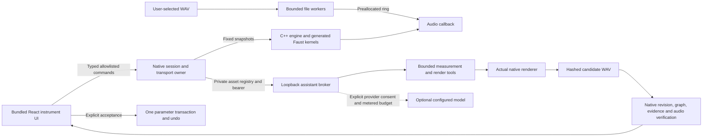

# Engineering review guide

ToneScope is a Windows audio microscope with an optional grounded assistant. This guide points to inspectable engineering decisions and tests; it is not a release or model-quality claim.

The audio callback performs no file/network access, JSON parsing or model work. The browser receives bounded measurements and opaque proposal IDs, never broker credentials or arbitrary filesystem access. Model output cannot apply parameters. Core audio works offline without the assistant runtime.

## Review paths

| Concern | Implementation and evidence |
|---|---|
| Actual DSP ownership | `dsp/faust/`, generated hashes, `docs/dsp/faust-stages.md`; the engine executes compressor, EQ and nonlinear kernels |
| Filter phase and delay | `docs/dsp/microscope.md`, `Analysis.cpp`, independent complex-response and declared-delay gates |
| Numerical evaluation | `evals/numeric.py`, frozen `gates.json`, `docs/evaluation/numerical-oracles.md`; independent analytic references and converged alias fixtures |
| Real-time ownership | `CaptureWorker.h`, `FilePlayback.h`, bounded command/ring queues and native allocation/block-invariance tests |
| Durable state | `Session.h`, `SessionRecovery.h`, native transport tests; strict versions, atomic snapshots, source verification and whole-patch undo |
| Grounded assistant | `AssistantBridge.h`, `AssistantIntegration.inc`, service tool/model/data cards; authenticated assets, actual rendered previews and explicit acceptance |
| AI evaluation | Adversarial B.3 graders, real native service probes, grouped frozen regression inventory and paired task-level analysis; inspectable seeds are not an unseen holdout |
| Build and release identity | Embedded `build-info`, evaluator/runtime/gate hashes and fail-closed release-check; consistency hashes do not establish reviewer authenticity |
| Private development delivery | Versioned allowlist ZIP, full retained notices, verified installation/rollback/uninstall and redacted diagnostics; unqualified and unsigned |

## Review history

Private PRs [#1](https://github.com/siddsan7/ToneScope/pull/1), [#2](https://github.com/siddsan7/ToneScope/pull/2) and [#3](https://github.com/siddsan7/ToneScope/pull/3) passed independent agent review and exact-head Windows CI before merge. [#4](https://github.com/siddsan7/ToneScope/pull/4) integrates the embedded frontend and subsequent native/service/package work ; its live status, exact-head checks and independent review comments record the delivery gate. Agent review is identified as such; no human approval is impersonated.

Independent reviews produced concrete regressions: low-rate initialization, extreme signed interval rejection, concurrent output publication, exact SDK selection, deep Windows Unicode paths, rollback version identity and reparse ancestry. Initial failures remain in the development evidence directories. Gates are not weakened to hide a failing implementation.

## What remains external

Physical interface/laptop lifecycle, callback timing and soak; licensed musical data and an independently owned sequestered holdout; human listening and accessibility; signing/licensing choices and clean-machine installation; and explicitly authorized provider-backed model qualification remain unperformed. Synthetic tests establish their mathematical and protocol assertions. They do not establish preferred tone, human usability, hardware performance or model competence.

`delivery/brain.md` is the compact implementation handoff; the full plan and references remain in durable project documentation. The development orchestrator delegates isolated bounded work, integrates it, commissions independent review, and owns the final evidence.
