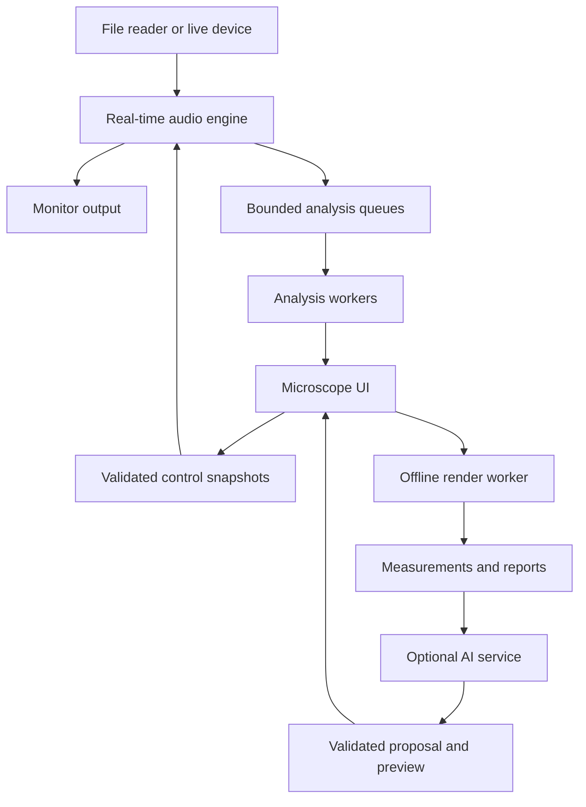

# ToneScope — production implementation and multi-agent delivery plan

Version: 1.0 • Prepared 2026-10-18 UTC / 2026-10-17 America/Phoenix

Status: implementation specification, not a claim that software or tests already exist. All numerical thresholds below are proposed project acceptance criteria, not measured results or universal audio standards. Pin and validate them before implementation; changes require evidence and independent review.

## 0. Read this first

### 0.1 Product mission

Build a Windows desktop guitar-effects application that makes tone changes audible, visible, and testable. Users process recorded or live audio, compare dry and processed sound fairly, select passages and frequency regions, investigate playing dynamics, and make informed adjustments. Faust supplies the DSP algorithms; a C++ desktop application supplies device handling, interaction, persistence, and orchestration.

The differentiator is **select → listen → adjust → verify**. The app must be musically useful and technically honest. A residual is a mathematical difference, not a guaranteed separation of added harmonics. A spectral display is evidence, not an objective judge of good tone.

### 0.2 Confirmed user decisions

| Decision | Requirement |
|---|---|
| Platform | Windows desktop; x64 first |
| Input | Recorded files and live input in first usable integrated version |
| Demo material | Clean guitar, soft/hard picking, chords and sustained notes |
| Available equipment | Laptop and headphones only; microphone can exercise live capture |
| Hardware qualification | Borrow/buy an interface later for direct instrument and round-trip tests |
| Scope | Effects engine plus audio microscope; no haptic hardware |
| Workflow | Multi-agent implementation; complete first version, then guided learning |
| Background | Comfortable programming; new to C++, audio programming and DSP mathematics |
| Schedule | Quality and technical depth; no artificial deadline |
| Audience | AI/software recruiters, DSP/audio engineers, Chaos Audio and OHLA |

### 0.3 Delivery levels

- **D1 / audio alpha:** files + live input, effects, transport, basic comparison; development build, not production claim.
- **D2 / audio 1.0:** full microscope, multiband mode, evaluation infrastructure, accessible interaction, packaged Windows release, qualified supported devices and release dossier.
- **D3 / AI edition:** optional evidence-based audio assistant with tool contracts, independent evaluation, privacy boundaries, benchmark report and controlled preview/apply. D2 remains useful offline.
- **D4 / later research:** Chaos hardware port, neural amp modeling, VST3 packaging or haptics. None is necessary to claim D2 completion; do not quietly expand scope.

D2 demonstrates DSP and systems engineering. D3 supplies direct evidence of AI engineering. Having coding agents write D2 is not, by itself, evidence of model development or AI evaluation expertise.

### 0.4 Agent launch instruction

Read this entire document. Create the repository artifacts named here. Implement in the PR dependency order. Use isolated branches/worktrees and explicit ownership. Build executable vertical slices; preserve a runnable main branch. Run applicable gates on every PR and the complete qualification suite on a release candidate. Never invent measurements, hide skipped tests, modify thresholds solely to pass, or claim human listening/hardware checks were completed by software agents. Keep a machine-readable progress manifest. Continue autonomously through reversible implementation; record concrete external blockers and complete independent work. Public distribution, purchases, account setup and disclosure of user audio require the user's applicable authorization. End with binaries, source, evidence, known limitations, and a learning walkthrough.

## 1. Product requirements and acceptance scenarios

### 1.1 Requirements registry

| ID | Requirement | Release |
|---|---|---|
| TS-001 | Import mono/stereo WAV PCM16/24/32 and float32, with duration/channel/rate validation | D1 |
| TS-002 | Device selection, live capture, explicit monitoring, negotiated buffer/rate display | D1 |
| TS-003 | Play/pause/seek/loop; dry recording for replay; cancelable file operations | D1 |
| TS-004 | Faust compressor, tone EQ, expressive overdrive, per-stage bypass | D1 |
| TS-005 | Dry/wet A/B with reported algorithmic delay and frozen level-match gain | D1 |
| TS-006 | Time selection and same-band audition on dry/wet | D2 |
| TS-007 | Aligned residual audition with raw and level-matched modes clearly distinguished | D2 |
| TS-008 | Spectrum, waveforms, input/output envelopes, gain-reduction timeline | D2 |
| TS-009 | Compare selected soft/hard passages and attack/decay behavior | D2 |
| TS-010 | Three-band compression and selectable stage order with safe reconfiguration | D2 |
| TS-011 | Atomic session/preset save, migration, missing-source recovery, deterministic render | D2 |
| TS-012 | Keyboard-complete core workflow, accessible names, scalable UI, non-color-only cues | D2 |
| TS-013 | Offline render/export and a reproducible comparison evidence bundle | D2 |
| TS-014 | Diagnostics, crash recovery and qualified installer/uninstaller | D2 |
| TS-015 | Optional assistant grounded in measurements, with preview/apply/undo | D3 |
| TS-016 | Evaluation suite and requirement-to-evidence traceability for every shipped feature | All |

### 1.2 Reference journeys

**J1 — understand distortion:** load a licensed DI guitar sample; enable drive; match playback level; switch A/B; select 2–5 kHz; audition both through identical band filters; lower tone/drive; return to full-band listening. Export settings and before/after audio. Acceptance: all comparison modes reflect the same source interval and settings revision, and the UI never presents stale measurements as current.

**J2 — inspect dynamics:** select a passage with soft then hard picking; compare detector input and gain reduction; change compressor attack; see and hear attack changes. Acceptance: metrics distinguish level from perceived loudness; selected passages can be manually corrected; no unsupported note-level certainty on chords.

**J3 — play live:** select input/output, enable monitoring, play/capture, stop, replay dry recording through current settings. Acceptance: display device-reported timing separately from measured round-trip timing; interface loss stops monitoring cleanly; no automatic switch to speakers or microphone.

**J4 — isolate a difference:** align dry/wet by known processing delay, choose raw residual, hear its magnitude; choose matched residual and see the applied gain. Acceptance: unity aligned processing nulls within declared tolerance; known delay test fails before alignment and passes afterward. Residual playback gain is visible and capped.

**J5 — AI diagnosis (D3):** select a harsh passage, ask for a less harsh version while preserving attack, receive measurements plus a bounded parameter proposal, preview a rendered candidate, compare level-matched audio, apply or undo. Acceptance: valid evidence IDs and session revision, no live mutation from model output, report measured tradeoffs rather than promise preferred tone.

### 1.3 Explicit exclusions

No third-party plugin hosting, artist-rig cloning, mandatory account, automatic upload of recordings, auto-generated Faust compilation in the shipped app, general shell access for the assistant, cloud requirement for audio processing, polyphonic transcription claims, hearing-health claims, or guaranteed universal low latency. Stereo files remain stereo; do not silently sum them. A mono guitar input can feed two identical monitor channels.

## 2. Architecture and implementation decisions

### 2.1 Proposed stack and first ADRs

| Layer | Default | Reason / prerequisite |
|---|---|---|
| App and audio host | C++20, JUCE, CMake presets, MSVC Windows build | Established desktop audio/device/UI abstractions; verify pinned release APIs |
| DSP | Faust source compiled ahead of time to C++; pinned compiler and standard libraries | Reviewable algorithms, portable engine; no runtime compiler dependency |
| Reference measurements | Python, NumPy/SciPy, pytest, locked environment | Independent numerical reference and report tooling |
| Native tests | CTest plus one selected C++ test library | Headless core verification and integration |
| Contracts | JSON Schema plus typed C++/TypeScript representations | Stable boundaries and strict validation |
| Optional agent runtime | Separate eve/TypeScript service, pinned version; provider adapter | Versioned tools/sessions; follow installed docs, keep outside audio process |
| CI | GitHub Actions, Windows build jobs and Linux portable DSP jobs | Windows packaging plus inexpensive math/sanitizer validation |
| Documentation | Markdown ADRs, generated HTML evaluation report, JSON/JUnit results | Reproducible evidence linked to commits |

Before copying JUCE code, read the exact pinned LICENSE.md and dependency terms. A commercial JUCE license may be required depending on distribution; record the chosen compatible licensing route and notices before public release. This document chooses no legal license on the user's behalf. WASAPI is the default Windows path; ASIO is a separately verified build option whose SDK licensing and device availability must be recorded. Do not select a dependency version from memory or track floating `latest` after bootstrap.

ADR-001: product boundaries and D1/D2/D3. ADR-002: JUCE/license and audio backends. ADR-003: Faust generation/reproducibility. ADR-004: threading/ownership. ADR-005: signal definitions and comparison semantics. ADR-006: datasets/oracles/gates. ADR-007: persistence/recovery. ADR-008: AI threat model and privacy. ADR-009: release support matrix. ADR-010: crossover topology and phase behavior.

### 2.2 Process and thread boundaries



- Audio callback: preallocated buffers, bounded operations, no allocation/free, locks, filesystem/network calls, UI calls, logging, exceptions or model inference. Audit hidden destruction, lazy initialization and library calls as well as explicit operations.
- Control/message thread: validates parameters, owns user actions, starts jobs. Parameters transferred by lock-free primitives proven lock-free on the target, or fixed-size SPSC queues. No plain shared non-atomic values justified by hardware assumptions.
- Graph reconfiguration: prepare new state outside callback. At a block boundary use a bounded transition; retire old objects outside callback. Do not let reference-count destruction execute on audio thread. For costly sample-rate/oversampling/order changes, fade out, reconfigure at a controlled stopped point, and fade in. Do not require two maximum-cost graphs to run simultaneously.
- Analysis workers: FFT, histories, segmentation, reports. Audio telemetry queue overflow drops analysis frames and increments a counter; it never stalls audio. Mark dropped/stale regions.
- File reader/writer: background buffered streaming. Recording overflow marks the take incomplete and stops recording; do not silently discard samples. Playback starvation fades to silence and reports the fault asynchronously.
- Optional AI process/service: unavailable without configured credentials/connection; has no dependency edge into audio processing. Core app startup and playback work with it absent.

### 2.3 Signal graph and measurement taps

Source → input trim → configurable sequence of compressor/EQ/drive → processed tap. Keep a pre-effect dry tap after input trim; both have the same input calibration. Post-comparison monitor gain/limiter is separate from analytical signals. Record raw source before effects with its calibration metadata.

Select one of dry, processed or residual; apply identical audition-band transfer functions to comparison branches; then apply monitor gain and emergency output guard. Bypass the audition filter when full-band is selected. Store displayed routing and selected mode in session state.

Host processing supports 44.1, 48 and 96 kHz where devices allow; offline files are resampled outside callback when needed with explicit metadata. Test odd and variable block sizes, including 1, 17, 63, 128, 257, 512 and 1024 frames. Actual device block sizes are negotiated, never hard-coded. Processing float32; reference calculations float64. No lossy source conversion without user-visible provenance.

### 2.4 DSP definitions to freeze before coding

**Compressor:** feed-forward detector, selectable peak/RMS only after both have defined semantics; default RMS. Threshold −60…0 dBFS; ratio 1…20; attack 0.1…100 ms; release 10…2000 ms; knee 0…24 dB; makeup −24…24 dB. Define detector integration and attack/release time convention mathematically. Ratio 1 with makeup 0 must be identity apart from declared latency. Stereo uses a linked detector to preserve image. No hidden auto makeup.

**Tone EQ:** low shelf, bell and high shelf; gains −18…18 dB; frequency constrained below 0.45×sample rate; Q 0.2…10 where applicable. Document topology, coefficient update strategy and smoothing. Prevent unstable interpolation; interpolate safe design parameters or crossfade prepared filter states with a measured transition.

**Overdrive:** documented pre-emphasis → drive gain → bounded waveshaper → post-tone/DC blocking → output trim. Start with a named mathematical transfer curve. Expressive response initially emerges from input amplitude; a later envelope-modulated option must be explicitly named and measured. Compare 1×/2×/4× oversampling with anti-imaging/anti-alias filters. Report group delay and resource cost. Do not call oversampling alias-free.

**Three-band compressor:** default crossover candidates 200 Hz / 2 kHz, validated ordered with a minimum spacing. Select a complementary topology with phase compensation for all three branches; do not assume two independently cascaded LR crossovers sum correctly. Measure flat summed magnitude and phase. Flat magnitude does not imply time-domain identity. Maintain a phase-matched uncompressed reference for isolating compression, and a separate raw dry comparison that retains crossover coloration.

**Parameter smoothing:** defaults documented per parameter (start with 10–20 ms for gain-like controls), measured not copied blindly. Delay-affecting changes invalidate comparisons until re-alignment. Range checks include NaN/Inf and sample-rate-dependent limits.

### 2.5 Microscope correctness

- A/B uses the same captured samples, selected interval and graph revision. Live dry/wet are observed simultaneously; historical comparisons use capture replay.
- Delay alignment defaults to known engine delay. For external files, cross-correlation is optional and confidence-qualified; low-confidence/nonlinear comparisons require manual review. Never use unrestricted time warping that conceals the phenomenon being analyzed.
- `raw_residual[n] = aligned_wet[n] − aligned_dry[n]`. `matched_residual[n] = g × aligned_wet[n] − aligned_dry[n]`. Save g, alignment, branch filters, latency and gain mode. Never label either “distortion only.”
- Initial level matching: integrated RMS over the exact non-silent selected region; freeze gain for audition, cap correction at ±12 dB, refuse on silence/insufficient data. Label it RMS matching, not LUFS/perceptual equality. If adding standards-based loudness later, implement and verify the actual standard.
- FFT: document window, FFT length, hop, coherent-gain/energy normalization, amplitude versus power units, one-sided scaling, smoothing and noise floor. Default 2048 samples/512 hop with zoom alternatives; audio path never waits for it. Spectrum timestamps use source sample positions, not UI arrival time.
- Frequency audition: show finite transition bands; do not promise a perfect rectangular spectral cut. Both branches use equal filters and state initialization. Time loops use short controlled fades; report their effect and exclude loop boundaries from attack metrics.
- Segmentation: envelope/onset heuristic, editable by user; confidence and ambiguous/chord cases visible. Do not equate a local maximum to a particular played note.
- UI modes: Play (effects), Inspect (linked selection/plots), Compare (A/B/residual), Evidence (export), Assistant (D3). Accessible labels, keyboard selection/numeric frequency entry, high contrast and line styles supplement color. No claim of accessibility effectiveness without testing.

## 3. Boundary contracts: every input and output

Every externally observable boundary gets a schema/typed contract, runtime validation where appropriate, test cases and a result identifier. Full offline evaluation is performed on changes and releases; per-sample model grading is prohibited. This is comprehensive boundary coverage, not a mathematically impossible claim to test every possible waveform.

| Boundary | Accepted input / invariant | Output / failure behavior | Required verification |
|---|---|---|---|
| WAV importer | Supported format, bounded metadata, finite decoded floats, 1–2 channels | Normalized AudioAsset metadata or typed import error | Truncation, oversized chunks, corrupt headers, zero length, hostile paths |
| Audio device | Negotiated rate, channel map, actual frame count | Complete output buffer; controlled stop on removal | Mock lifecycle plus real Windows device matrix |
| Callback samples | Declared layout/count, finite sanitized samples | Finite initialized samples; fault counter and bounded mute on invalid state | Poison-buffer, NaN/Inf, extremes, aliasing/in-place tests |
| Parameter changes | ID, unit, finite range, revision | Accepted value or rejection; last valid state retained | Fuzz, exact boundaries, concurrent updates |
| Processing graph | Known stage IDs/order and prepared resources | Immutable active revision with latency metadata | Invalid order/state, repeated changes, teardown races |
| Analysis packet | Source/revision/sample interval/rate/units | Measurement validity and stale/dropped flags | Out-of-order frames, overflow, stale completion |
| Time/frequency selection | Bounds within source and Nyquist | Canonical sample interval/filter specification | Empty/one-sample/end-of-file selections |
| Comparison | Matching source revision, delay, gain and window | A/B/residual or explicit not-ready | Unity/null tests; known gain/delay/phase fixtures |
| Session/preset | Version, bounded JSON, known IDs, source digest | Atomic saved state; recover previous file on failure | Migration, unknown version, disk-full, missing source |
| Recording/export | Selected path, duration/format, available writer | Complete audio plus provenance; incomplete flag on fault | Read-back frame count, clipping policy, cancellation, no overwrite without action |
| Assistant request | User instruction, selected session snapshot, allowed evidence | Bounded job ID; cancellation/timeout | Limits, redaction, malicious metadata |
| Tool invocation | Strict name/schema/ranges and revision | Typed measurement/preview ID or error | Unknown tools, illegal paths, stale revisions |
| Model response | Evidence-backed JSON proposal | Preview-only proposal; rejected invalid output | Unsupported claims, invalid values, missing evidence |
| Apply proposal | Valid preview + matching session + explicit Apply | Undoable transaction | Concurrent edit, replayed proposal, partial failure |
| Release package | Exact tested commit/build/toolchain manifest | Installer/hash/SBOM/attestation | Install/upgrade/uninstall/offline launch/signature verification |

### 3.1 Core types

`AudioAsset`: id, schema_version, source_sha256, format, sample_rate_hz, channels, frames, origin, license_id, captured_at, validity.

`ParameterSpec`: stable id, stage_id, unit, minimum, maximum, default, scaling, smoothing, sample_rate_constraints, schema_version. GUI and AI consume the same registry; native engine still validates independently.

`Measurement`: id, metric_version, source_sha256, graph_sha256, selection_samples, sample_rate_hz, units, value, validity, confidence_if_defined, analysis_settings, timestamp, provenance. Missing/invalid values use explicit null/status, never fabricated zero.

`Session`: schema_version, source references/digests, channel mapping, graph, parameter values, selections, comparison configuration, UI layout. Device preferences are optional and machine-specific. Credentials and raw model keys are never embedded.

`EvaluationResult`: run_id, case_id, requirement_ids, suite_version, oracle_version, commit_sha, artifact_sha256, fixture_sha256, seed, platform, configuration, measured_value, unit, threshold, comparator, status(pass/fail/skip/blocked), evidence_paths, duration. Missing evidence never maps to pass.

### 3.2 Limits and resource policy

Default file input: up to 2 channels and 2 hours via streaming, supported WAV sizes bounded by decoder/container limits; unsupported/RF64 paths return explicit errors until implemented. First version support files up to 2 GiB and exported recordings below that limit; stop before exceeding it. Analysis uses bounded windows/decimated histories, never copies full long files repeatedly. Session JSON cap 5 MiB. AI request cap 8 KiB text, 32 measurements, 8 tool calls, 3 candidate renders, 30 seconds total candidate audio, 60 seconds request wall time; revise only via ADR. Analysis queue capacity expressed in frames/seconds with measured memory. Set explicit limits for every RPC and worker queue.

## 4. Repository structure and engineering artifacts

| Path | Responsibility / owner |
|---|---|
| `apps/desktop/` | Windows shell, views, commands, accessibility; UI agent |
| `libs/audio-engine/` | Host-independent engine, routing, RT ownership; audio agent |
| `dsp/faust/` | Authored DSP; DSP agent |
| `dsp/generated/` | Generated outputs/manifests, never hand-edited |
| `libs/analysis/` | FFT, meters, comparison, segmentation; analysis agent |
| `libs/contracts/` | Stable schemas/parameter registry; integrator owns |
| `libs/session/` | Persistence/migration; app agent |
| `tools/render-cli/` | Headless renderer using same DSP core |
| `services/audio-assistant/` | D3 eve tools/prompts/provider/session logic |
| `evals/reference/` | Independently authored Python oracles |
| `evals/cases/`, `evals/manifests/` | Versioned case definitions, requirements mapping, split manifests |
| `evals/graders/`, `evals/reports/` | Deterministic graders, report generation; no mutable baselines here |
| `tests/native/`, `tests/integration/`, `tests/gui/`, `tests/fuzz/` | Engineering verification |
| `benchmarks/`, `qualification/` | Dedicated-host measurement and human/device protocols |
| `.github/workflows/`, `.github/PULL_REQUEST_TEMPLATE.md` | CI/review automation |
| `docs/adr/`, `docs/dsp/`, `docs/runbooks/`, `docs/learning/` | Decisions, mathematics, support, education |
| `AGENTS.md`, `CODEOWNERS`, `SECURITY.md`, `CONTRIBUTING.md` | Rules and review boundaries |
| `delivery/progress.json`, `delivery/pr-manifest.yaml` | Task state, dependencies, ownership, blockers |
| `releases/manifest.schema.json` | Evidence and support matrix contract |

Large licensed recordings/artifacts live in versioned artifact storage or Git LFS as appropriate; git contains checksums and acquisition/license instructions. No private recordings in public CI. A clean clone must reproduce synthetic fixtures without network audio downloads.

## 5. Multi-agent operating model

### 5.1 Team and ownership

| Role | Owns | Must not do |
|---|---|---|
| Lead/integrator | Contracts, ADR decisions, task DAG, cross-module integration, release manifest | Rubber-stamp own implementation as independent review |
| DSP engineer | Faust algorithms, mathematical notes, reference design proposals | Change evaluator thresholds to match their output |
| Audio systems engineer | Device lifecycle, callback, state handoff, rendering/recording | Put UI/AI/filesystem work in callback |
| Analysis/UI engineer | Measurements, selections, displays, keyboard flows | Treat plot appearance as correctness evidence |
| Evaluation engineer | Independent oracles, fixtures, mutation tests, reports | Import implementation formula as sole truth |
| AI engineer | D3 tools, prompts, grounding and model adapter | Change engine parameters directly from model text |
| Reviewer/release engineer | Independent review, threat scenarios, Windows qualification and packaging | Claim unperformed listening or physical tests |

Use up to 4 implementers concurrently plus integrator/reviewer when available. One agent can hold roles sequentially, but independent review must be a separate run/context; agents are not independent human auditors. Do not spawn idle roles just to appear enterprise-like.

### 5.2 Work isolation and coordination

1. Integrator merges PR-00..03 contract/test scaffolding before broad parallelism.
2. Each task has requirement IDs, base commit, allowed paths, contract versions, dependencies, acceptance cases and expected artifacts.
3. Use a separate git worktree and branch `feat/TS-xxx-short-name` per implementer. Shared workspace is not permission for overlapping edits.
4. Contract changes require integrator review and a compatibility/migration plan before downstream adoption. Generate typed bindings in the contract PR.
5. Implementer submits a focused PR with test evidence and exact head SHA. Reviewer runs independent boundary/failure checks and records findings.
6. Integrator rebase/merges through protected main and reruns affected checks on integration commit. Stacked PRs are explicitly based on their predecessor; no hidden dependencies.
7. A failing integration pauses dependent work. Preserve reproduction seed/artifact; fix root cause in a focused PR. Do not rerun until green and discard failed attempts.
8. Progress state: planned → ready → in_progress → review → verification → merged, or blocked. Blockers name the missing device/license/credential/person and remaining independent tasks.

### 5.3 Task handoff template

```yaml
task_id: TS-006-band-audition
base_commit: REQUIRED_SHA
owner_role: analysis
allowed_paths: [libs/analysis, tests/native/band_audition]
depends_on: [PR-03, PR-07]
contracts: [AudioAsset-v1, ParameterSpec-v1, Measurement-v1]
requirements: [TS-006, TS-016]
acceptance_cases: [SEL-01, SEL-02, CMP-04]
deliverables: [code, tests, measurement-report, docs]
reviewer_role: evaluation
status: planned
```

### 5.4 Review and merge rules

Protected main: required Windows build, contracts, native/DSP checks, boundary tests, risk-selected evaluations and secret/license checks. No force pushes, direct main commits, skipped checks or self-approved baseline changes. Author cannot serve as independent reviewer. Changes to gates/oracles/datasets require evaluation-owner review; signal-path changes require DSP/audio review. One independent substantive review per normal PR; two role reviews for contracts, callback, comparison semantics, evaluators and security-sensitive AI changes.

Reviewers answer: what failure can this introduce; what independent evidence catches it; does the user-facing claim match what was measured? Formatting-only reviews are insufficient.

## 6. Structured PR delivery plan

Each row is a bounded deliverable. Split oversized rows into a/b PRs preserving dependencies and acceptance criteria. Tests and docs ship with the feature; no final “add all tests” phase.

| PR | Title / owner | Depends on | Implementation and required evidence |
|---|---|---|---|
| 00 | Repository charter / lead | — | PRD, AGENTS, ADR index, support labels, requirement registry, ownership, blocker manifest |
| 01 | Reproducible toolchain / release | 00 | Pinned compiler/deps, CMake presets, clean Windows build, lockfiles, license inventory |
| 02 | Contracts and parameter registry / lead | 01 | Strict schemas, unit conventions, error taxonomy, generated types, invalid-input cases |
| 03 | Evaluation skeleton / eval | 02 | CLI runner, result schema, fixtures, report, intentional failing case proving CI blocks |
| 04 | Headless engine and renderer / audio | 02,03 | Identity pipeline, streaming render, rate/channel/block handling; null and round-trip tests |
| 05 | Windows live device shell / audio | 04 | WASAPI input/output selection, explicit monitoring, dropout counters, simulated unplug tests |
| 06 | File transport and dry recorder / app | 04,05 | WAV load, playback/seek/loop, capture replay; incomplete-take and disk-failure handling |
| 07 | EQ and smooth parameters / DSP | 04 | Filter response oracle, sweep/poles/extremes, control-change artifact report |
| 08 | Compressor / DSP | 04 | Gain curve, knee/timing tests, stereo link, musical fixtures, reset/silence behavior |
| 09 | Oversampled overdrive / DSP | 07 | Waveshaper spec, resampling filters, alias sweep, CPU/latency quality matrix |
| 10 | Metering and analysis transport / analysis | 04 | Timestamped queues, FFT/envelopes, dropped-frame handling, calibration fixtures |
| 11 | Integrated effects interface / UI | 05–10 | Files+live full-band effects app, keyboard basics, undoable parameters; pre-D1 integration demo |
| 12 | Fair A/B and alignment / analysis | 09–11 | Explicit delay and frozen RMS gain, raw/matched semantics, silence handling, known-delay tests; D1 acceptance demo |
| 13 | Time/frequency microscope / analysis | 10,12 | Linked selections, identical-band audition, loop fades, stale-job cancellation |
| 14 | Residual and dynamics views / analysis | 08,12,13 | Null/gain/phase fixtures, manual segmentation, explanatory UI, no distortion-only claims |
| 15 | Three-band processing / DSP | 07,08,12 | Phase-correct crossover design, neutral sum response, matched reference, band gain tests |
| 16 | Reorderable graph / audio | 09,15 | Prepared graph swaps, latency invalidation, bounded stop/restart, stress/ownership tests |
| 17 | Sessions, export and recovery / app | 13–16 | Atomic persistence/migration, WAV export/read-back, source hashes, evidence bundle |
| 18 | Accessible interaction and usability / UI | 17 | Keyboard/screen-reader/manual scaling protocol, small musician study, fixes and limitations |
| 19 | Adversarial and performance hardening / eval+audio | 16,17 | Fuzz/sanitizers, memory/queue faults, hotplug, soak, dedicated-host budget reports |
| 20 | Windows release packaging / release | 18,19 | Clean-machine install/update/uninstall, notices/SBOM, signatures when available, D2 dossier |
| 21 | AI tool contracts and fixtures / AI+eval | 03,17 | Measurement read, render preview, schema proposal, immutable holdout, baseline rules |
| 22 | Assistant service and UI / AI | 21 | eve scaffold pinned/docs-led, provider adapter, privacy controls, bounded loop, preview/apply/undo |
| 23 | AI evaluation and ablations / eval | 22 | Live model benchmark, deterministic replay, attack cases, baselines, confidence intervals |
| 24 | AI qualification / release | 20,23 | D3 gate, cost/latency report, network-failure tests, supported provider/config manifest |
| 25 | Portfolio evidence and learning / lead | 20 (D2),24 (D3) | Two founder demos, architecture tour, failure case study, engineer walkthrough, honest scorecard |

Parallel waves: after 04, device/transport, DSP blocks and measurement work can proceed independently. After 17, D2 hardening and D3 contracts/datasets can proceed in parallel. No assistant code depends on unfinished GUI internals; use versioned snapshot/preview contracts.

### 6.1 PR template

```markdown
## Problem and resulting behavior
Concrete user-visible change; requirement IDs; before/after example.
## Scope and contracts
Changed modules, contract versions, migrations and dependency PRs.
## Design and tradeoffs
Relevant ADR; latency/phase/resource/UX consequences.
## Evidence
Exact commit and artifact hashes; test/eval run IDs; baseline comparison;
fixture/model/compiler versions; listening files/screenshots if relevant.
## Failure behavior
Invalid input, cancellation, overflow, stale state and rollback behavior.
## Review focus
Risks needing DSP/audio/evaluation/security review.
## Remaining limitations
Unrun checks explicitly blocked/skipped with reason and owner.
```

## 7. Evaluation system: architecture and operating policy

### 7.1 Four distinct layers

1. **Runtime contracts:** cheap finite/range/version checks, bounded queues, complete output buffers and typed errors; always active.
2. **Engineering verification:** unit, integration, property/metamorphic, sanitizer, fuzz, GUI and migration tests; PR/nightly gates.
3. **DSP/product qualification:** independent numerical oracles, dedicated performance runs, listening and usability studies; release gates.
4. **AI evaluations:** tool correctness, evidence grounding, task outcomes, adversarial robustness, model cost/latency and human preference; D3 gates.

An agent code review is not an evaluation suite. An LLM judge is an advisory grader for some semantic qualities, not a signal-processing oracle. Overall averages cannot hide a critical contract or safety failure.

### 7.2 Dataset and split design

- Synthetic: impulses, DC, silence, bin-centered/off-bin sines, sweeps, multitone/intermodulation signals, noise with fixed seeds, stepped envelopes, full-scale and out-of-range float cases.
- Musical: legally sourced DI guitars covering soft/hard picks, sustained notes, chords, muted notes, several pickups/players, silence and noise. Include off-domain voice/drums to test graceful behavior without optimizing claims for them.
- Invalid: corrupt/truncated WAV, huge headers, malformed sessions, invalid parameters, stale graphs, missing devices, failed writes, malicious names/metadata.
- AI: objectively measurable issues with known interventions, subjective requests, underspecified requests, impossible requests, already-good/no-op cases, adversarial instructions and tool failures.
- Split by original recording/player/instrument/session before slicing. Derived clips and perturbations stay in the parent's split. Deduplicate by hash and near-duplicate checks. Separate development, validation and locked test manifests.
- Suggested D2 seed: 60 synthetic families with parameterized seeds, 24 diverse licensed DI recordings, 40 fault cases; expand based on coverage, not bulk.
- Suggested D3 corpus: 240 independently specified tasks, 120 development / 60 validation / 60 locked test, plus 60 adversarial/failure cases. Keep at least 10 cases per critical category; report counts and uncertainty. A small holdout supports a limited claim, not universal reliability.
- Evaluation owner maintains holdout cases separately from implementation tuning. Repeatedly inspected holdout cases become regression tests; refresh final holdout before new headline claims.

### 7.3 Proposed numerical gates

These are initial targets. Freeze fixture, warmup, metric definition, domain and tolerance in PR-03 before the corresponding feature. A feasibility adjustment needs an ADR and baseline evidence, never a silent change in the feature PR.

| Gate | Proposed pass criterion / scope |
|---|---|
| E-CONTRACT | 100% accepted/rejected behavior matches schema cases; no critical boundary untested |
| E-FINITE | No NaN/Inf in output on full declared input domain; invalid source causes bounded fault handling |
| E-IDENTITY | Identity path max absolute error ≤1e−6 normalized full scale after declared delay; in-place/out-of-place agree |
| E-RENDER | Same source/settings reset yields deterministic results on pinned platform; cross-platform tolerance explicitly separate |
| E-BLOCK | Variable-block render versus fixed-block reference ≤1e−5 max absolute error for applicable deterministic algorithms |
| E-EQ | Frequency response within 0.2 dB of independent reference over specified passband; use absolute/complex error near nulls |
| E-COMP | Steady-state gain within 0.25 dB of analytic curve; attack/release measured against declared convention within 10% or 2 samples, larger allowance |
| E-XOVER | Neutral three-band summed magnitude within ±0.25 dB over 30 Hz…min(18 kHz,0.4fs); phase behavior documented separately |
| E-ALIAS | Selected high-drive stress fixtures show ≥10 dB alias-error reduction at chosen quality mode versus 1×, against converged high-rate reference; publish full sweep and exceptions |
| E-MATCH | Frozen selected-region RMS match within 0.25 dB where signal is valid and gain cap not reached; otherwise explicit constrained/invalid status |
| E-ALIGN | Known integer delay recovered exactly; optional fractional estimator error ≤0.1 sample only on defined high-confidence fixtures |
| E-RESIDUAL | Identity null RMS below −100 dBFS for eligible aligned float32 fixtures; report absolute error near silence |
| E-METER | RMS/sample peak within 0.1 dB of reference above −80 dBFS; FFT sinusoidal amplitude within 0.2 dB for declared calibration cases |
| E-AUTOMATION | No unexpected nonfinite output, discontinuity or unstable state; transition error assessed against smooth independent reference, not raw sample derivative alone |
| E-SESSION | Every migration fixture restores intended state; interrupted write retains old or new complete file; no partial session |
| E-EXPORT | Correct format/channels/frame count, read-back tolerance by bit depth; no silent saturation, overwrite or normalization |
| E-RT-OPS | Zero callback allocations/frees and no forbidden blocking calls in instrumented representative paths |
| E-RT-BUDGET | On qualified hardware: processing p99.9 <50% of buffer period and observed max <80% in 30-min stress; record deadline misses separately |
| E-SOAK | 2-hour declared workload on qualified device: no app-caused underruns, crash or unbounded queues; memory growth <10 MiB after warmup |
| E-UI | Meter/selection feedback p95 <100 ms on qualified machine; no UI work that blocks audio |
| E-RECOVERY | Simulated device/file/service failures produce recoverable errors with no corrupted completed assets |

For E-ALIAS, compare delay/gain-aligned bandlimited high-rate references, confirm reference convergence by increasing rate, account for resampler error, and distinguish intended harmonics from folded components. Do not claim every nonlinear sample improves by a fixed amount. For transition tests, a musically valid attack can have a large sample derivative; arbitrary jump thresholds create false failures.

### 7.4 Performance qualification matrix

Record CPU model, RAM, OS build, power policy, compiler flags, audio backend, device/driver version, sample rate, buffer size and graph. Core support starts on Windows 11 x64; add other Windows versions only after qualification. Developer laptop and one external-interface Windows machine are separate profiles.

Test 44.1/48 kHz at 128/256/512 frames where supported and 96 kHz at supported buffers. Full chain at 4× oversampling is a stress profile; select a lower supported default if it exceeds budget and document the tradeoff. Callback period is frames/fs; it is not end-to-end latency. Publish actual loopback round-trip measurements separately, including method and uncertainty. Proposed preferred interface profile target: ≤15 ms round trip at a supported setting, qualification required; laptop/Bluetooth paths get their measured behavior, no low-latency claim.

VM/cloud CI can verify functionality but cannot certify device timing. Instrumentation overhead must be measured; use release builds for timing, separate sanitizer builds for memory correctness. Shared CI timing is trend-only. Record all failures, not just best run. An unavailable device test is blocked, not passed.

### 7.5 Oracle independence and evaluator testing

- Implement the reference from math/specification rather than copying Faust output.
- Triangulate analytic tests, an independently implemented reference, and musical listening.
- Property tests: linear EQ obeys superposition within tolerance; ratio-1 compressor identity; linked channels preserve equal-input symmetry; silence settles; resets remove prior state; sample chunking invariance; A/B gain and delay injection produce expected residual.
- Mutation suite intentionally removes smoothing, changes a dB factor, swaps channels, introduces one-sample delay, breaks RMS normalization, corrupts schema version and bypasses tool validation. Relevant evaluators must fail.
- Golden files supplement references; update through dedicated baseline PR with plots/audio explanation, not automatic overwrite.
- Coverage report maps every TS requirement and contract boundary to cases. Numerical line coverage is supplementary; require branch coverage for validation/error paths and mutation detection for critical invariants.

### 7.6 Human listening and OHLA-relevant usability

Recruit an initial 5–8 guitarists/audio practitioners for formative sessions; include people with relevant access needs when making accessibility claims. Describe selection bias and small sample size. Do not claim statistical generalization from this pilot.

Randomize/counterbalance task order, use matched levels where appropriate, conceal preset identity during tone comparisons, and compare microscope workflow with an effects-knobs-plus-spectrum baseline. Tasks: identify a harsh passage, reduce it while preserving attack, explain compressor response. Record completion rate/time, wrong adjustments, confidence and qualitative comments. Obtain recording consent and avoid collecting unnecessary identifiers.

Exit target: no unresolved critical task-blocking usability defects; ≥80% completion of core tasks in the pilot is a proposed goal, reported with counts and uncertainty. Improvements over baseline are a research question, not a prewritten result. Record failures and design changes. A person must listen; an agent cannot certify pleasantness or accessibility from plots.

## 8. Optional AI engineer portfolio extension

### 8.1 Purpose and bounded capability

The assistant interprets a request, obtains measured evidence, proposes a bounded change, renders a preview, evaluates measurable constraints, and explains the tradeoff. It cannot autonomously “know good tone.” No model executes in the audio callback, changes live sound, runs shell commands, writes arbitrary files or compiles generated DSP.

Tools:

| Tool | Input | Output |
|---|---|---|
| `get_session_snapshot` | session ID/revision | Read-only graph/selection/parameter ranges |
| `get_measurements` | authorized measurement IDs/selection | Versioned measurements with validity/units |
| `render_candidate` | bounded allowlisted parameter patch and source selection | Preview ID, audio hash, latency/gain metadata |
| `compare_candidate` | original/preview IDs and named constraints | Deterministic metric deltas and validity |
| `propose_change` | patch, evidence IDs, explanation, tradeoffs | Validated proposal; never applies it |

`apply` is a native UI command after a user click, not an LLM tool. It checks session revision and preview hash, creates one undo transaction, and rejects stale proposals. Use authorized asset IDs rather than filesystem paths in tool schemas.

### 8.2 Runtime and privacy

Use a separately versioned eve TypeScript agent service; scaffold only at PR-22, pin the generated dependency graph, and read its shipped docs. Keep an adapter boundary so model providers can be evaluated without touching DSP. Default provider routing follows the chosen gateway; exact model and pricing are selected at implementation from current documentation and recorded in manifest.

Core audio remains local. By default send only selected numerical measurements and user text after explicit opt-in; do not send raw recordings, absolute paths or hidden metadata. If later supporting audio-model input, require separate disclosure and consent plus fixture/data policy. Store credentials using appropriate OS/service secret facilities, never session JSON. Redacted traces are exportable by user action. App supports complete deletion of assistant history. Offline/server failure leaves audio unaffected.

### 8.3 Assistant state machine

Idle → validating_request → collecting_evidence → proposing → rendering_preview → evaluating_preview → ready_to_compare → applied or dismissed. Any step can become canceled/timed_out/failed. Session edits invalidate pending proposals. Persist step IDs and request IDs; retry only idempotent reads/renders with bounded backoff. A retry must not duplicate state changes. Limit tool budget as specified in §3.2; render worker receives only validated data, not executable model output.

### 8.4 AI evaluation design

Use deterministic grading first:

- Schema/tool validity, units, ranges, authorized IDs, maximum calls, and stale-state behavior.
- Every numerical factual claim resolves to a measurement ID and matches its value/tolerance.
- Objective tasks measure before/after constraints: e.g., reduce selected-band energy by a specified amount while keeping attack metric within a specified bound. These constraints are task fixtures, not universal definitions of good audio.
- Refusal/clarification is correct for missing data, invalid measurements and impossible simultaneous constraints.
- No-op is acceptable when the stated target is already met; unnecessary processing counts against quality.
- Attack suite: prompt injection in filename/metadata/tool result, forged metric IDs, instructions to reveal keys/upload audio, arbitrary file paths, malformed JSON, timeout, rate limit, tool error and fabricated success.

Compare **no assistant**, **deterministic rules**, **single model response without tools**, and **tool-grounded assistant**. Include a grounding-disabled ablation to test whether tools improve factual accuracy. Same datasets, constraints and budget. Report model/provider/snapshot, prompt hash, temperatures, tool versions and repeat count. Run each nondeterministic holdout task 3 times, preserving all outcomes; compute confidence intervals clustered by original task rather than treating repetitions as independent new tasks.

Proposed D3 acceptance gates:

| Metric | Gate |
|---|---|
| Runtime invalid proposal rejection | 100% of invalid/adversarial contract cases |
| Unauthorized application/upload/path access | Zero observed across suite; any occurrence blocks release |
| Raw model proposal schema validity | ≥98%; runtime still rejects remaining invalid proposals |
| Numeric factual grounding | ≥99% on numeric claims; no fabricated critical evidence |
| Objective task success | ≥85% on declared feasible holdout tasks; critical slices reported separately |
| Missing-evidence abstention | ≥95% on dedicated cases |
| Rules baseline comparison | Report paired difference and CI; no claim of superiority if inconclusive |
| Explanation quality | ≥4/5 median human rubric score, with disagreement and sample count |
| Budget handling | All runs terminate within configured limits; timeouts are visible failures, never success |

Thresholds are targets requiring calibration against actual corpus difficulty. Human judges rate explanation usefulness and preference; LLM-as-judge may triage contradictions or rubric adherence only. Calibrate an LLM judge against independently labeled human cases, report disagreement, and never let it certify numeric DSP correctness. Exclude invalid/infeasible cases from success denominator only by predeclared labels, never after seeing model performance.

### 8.5 AI evidence artifacts

`model-card.md`, `dataset-card.md`, `prompt-version.json`, tool schema bundle, redacted traces, per-case results, failure taxonomy, ablation report, latency/cost distributions and a reproducible runner. Measure currency cost from actual usage and current rates; do not invent a free budget. Mocked provider runs validate engineering, not live model capability.

## 9. CI, evaluation routing and release gates

### 9.1 Pipelines

| Pipeline | Trigger | Blocking evidence |
|---|---|---|
| `pr-contracts` | Every PR | Schemas, requirement map, formatting, generated-source drift |
| `pr-windows` | Every code PR | Clean Windows compile, native tests, smoke app start |
| `pr-dsp` | Engine/Faust/analysis/math changes | Independent response/curve/null/alias/selection cases |
| `pr-integration` | UI/session/device/control changes | Journeys with mock device, persistence, cancellation |
| `pr-ai-replay` | AI/tools/prompts/contracts | Recorded deterministic tool flows, attacks, invalid outputs |
| `nightly-full` | Nightly/main | Full synthetic+musical regression, fuzz, sanitizers, migration |
| `model-eval` | Model/prompt/tool change and D3 RC | Live-model holdout and budget report; secrets only in trusted jobs |
| `hardware-qualify` | RC and engine/device changes | Dedicated Windows device stress, loopback, soak, manual record |
| `release-candidate` | Tagged candidate | Full gates + artifact build, install/upgrade/uninstall, SBOM/manifest |

Risk routing uses a committed dependency map. A changed contract, build flags, resampler, generated code or DSP core fans out to all affected suites. Unknown/unmapped changes run the full suite. Documentation-only changes may skip executable checks if no generated/spec/eval requirements changed. Nightly and RC full runs catch routing mistakes. Every gate status appears in manifest.

Proposed PR fast suite budget ≤15 min; shard independent jobs and cache by pinned dependency hash. Do not remove meaningful tests to meet a speed target. Heavy alias/fuzz/performance work runs nightly and before relevant merge/release according to the declared risk map.

### 9.2 Failure and exception policy

Hard failures: nonfinite output, memory error, data loss, unauthorized action, invalid comparison semantics, license/provenance omissions, missing critical evidence. No waivers for these in a production release.

A noncritical flaky GUI test can be quarantined only with a tracked reproduction, owner, expiry, alternative evidence and reviewer approval; it remains visible and does not convert into pass. Baseline changes require a separate reviewed PR. If infrastructure is unavailable, mark blocked and publish only the qualified subset as prerelease if useful; never silently ship a full-support claim.

### 9.3 Supply chain and release

Pin dependencies, compiler, Faust libraries, CI actions and AI prompts/models where provider snapshotting is available. Scan secrets and dependency advisories; review relevant findings. Build unsigned payload reproducibly where feasible; timestamps/signing may prevent byte-identical installers, so record deterministic payload hashes and signed artifact identity separately.

Release package: installer or portable package, SHA-256 sums, SBOM, third-party notices, support matrix, exact commit/toolchain manifest, evaluation report, migration notes, rollback instructions and known limitations. Code-sign Windows artifacts when a certificate is available; otherwise clearly label unsigned prerelease and do not claim trusted enterprise distribution. Use artifact attestations when supported by the hosting setup. Signing credentials never enter untrusted PR jobs.

Clean machine: install without developer tools, offline launch, import/play, save/reopen, microphone/live test, upgrade with previous sessions, uninstall without deleting user sessions, reinstall, recover from simulated interrupted write. Avoid auto-update in D2; a later updater requires signature verification, rollback and update-specific tests.

## 10. Production operations and support

Local diagnostics contain build ID, device configuration, queue overflows, underrun counts, worker errors and invalid-state counters. No waveform contents, filenames, paths or credentials in default logs. Export redacted support bundle by explicit user action. Ring buffers bound logs and counters; telemetry consumption is off callback. Crash recovery offers previous complete session and incomplete recording with clear status.

Runbooks: device unavailable, no audio, crackles/high CPU, stale analysis, wrong sample rate, file decode error, missing source, corrupt session, disk-full recording, assistant unavailable, invalid proposal, rollback/migration. Each names a symptom, diagnostic fields, safe recovery and escalation evidence.

No cloud ops stack is needed for D2. For D3 remote service, add authenticated sessions, authorization per asset/session, request limits, bounded storage retention, spend limits and service-health metrics. Audio remains unaffected during service incidents. Do not add Kubernetes, queues or distributed services without a demonstrated requirement.

## 11. Release scorecard and honest portfolio narrative

### 11.1 D2 release checklist

- [ ] TS-001 through TS-014 and TS-016 mapped to passing evidence on exact RC.
- [ ] Independent DSP oracles and mutation checks passed.
- [ ] Windows support matrix includes actual device/laptop qualification or clearly blocked paths.
- [ ] Reference samples have documented licenses and consent.
- [ ] Listening and accessibility/usability protocol completed by humans; limitations stated.
- [ ] Installer, notices, hashes, SBOM, migration and recovery verified.
- [ ] No critical defects or unsupported claims; reviewed release manifest complete.

### 11.2 D3 checklist

- [ ] D2 remains independently operable offline.
- [ ] Tool authorization and strict response validation passed adversarial suite.
- [ ] Live model benchmark, baselines, repeats, confidence intervals and cost recorded.
- [ ] Privacy/opt-in paths and undo/stale-proposal behavior verified.
- [ ] Human explanation/usefulness review completed.
- [ ] Model/tool/prompt changes trigger evaluations; dataset leakage controls recorded.

### 11.3 Demo package

**Chaos demo, 3 minutes:** clean guitar → expressive drive/compression → level-matched listening → alias/CPU tradeoff → smooth live controls → exact evidence report. A desktop benchmark is not a Cortex-A8 benchmark. Later hardware port requires current official ABI review and actual device tests.

**OHLA demo, 3 minutes:** select a difficult-to-hear change → redundant visual/aural feedback → keyboard-driven adjustment → compare task results from pilot. Explain what was learned from users and what remains untested. Do not imply collaboration or endorsement.

**AI recruiter demo, 5 minutes:** grounded request → typed tools → measurements → validated proposal → preview/undo → failed/adversarial case → benchmark against rules baseline. Be candid about third-party model use; no claim of training unless training was actually implemented and evaluated.

Include one failure case study: an apparent improvement that disappeared after level matching, a phase-induced residual, an aliasing/CPU compromise, or an assistant recommendation rejected by constraints. Show reproduction, hypothesis, experiment, fix and regression gate.

## 12. Learning handoff after implementation

Create `docs/learning/00-start-here.md` and ten short experiments using the shipped app and repository: samples/dBFS; filters/phase; compressor curve; attack/release; nonlinear harmonics; aliasing/oversampling; latency/buffering; residual interpretation; real-time ownership; evidence-grounded tools/evals. Each has a prediction, control to change, audible result, plotted measurement, code pointer and limitation. Explain generated Faust C++ separately from authored algorithm code. Provide a 30-minute architecture tour and two small modifications the user can implement themselves with regression checks.

## 13. Concrete agent kickoff prompt

> Build ToneScope using this specification. This is an implementation task, not a request for another plan. First inspect the repository/environment, read applicable AGENTS instructions, and create the PR-00..03 foundation. Use a lead integrator, DSP engineer, audio systems engineer, analysis/UI engineer, evaluation engineer and independent reviewer with isolated worktrees; activate the AI role for PR-21 onward. Create and maintain the requirement/evidence map and dependency manifest. Pin tools and licenses using current official documentation. Keep the audio core free of UI/network/model dependencies. Implement D1 then D2; implement D3 as separately gated optional functionality. Use strict boundary validation, independent numeric oracles and machine-readable reports. Never weaken a gate without a separately reviewed rationale. Never report mocked hardware/model checks as real qualification. If the host is not Windows, implement portable work and Windows CI while recording native device/signing/manual checks as blocked until evidence is available. Produce structured PRs in dependency order, a packaged qualified release or clearly labeled prerelease, evidence dossier, and learning walkthrough. Continue until the declared scope is complete or remaining work depends on a concrete unavailable external resource; do not pause for routine reversible engineering decisions.

## 14. Official references and implementation-time verification

Checked 2026-10-18; pin exact versions at bootstrap. These sources ground platform choices; the project thresholds and feature design above are proposed engineering decisions.

1. Faust compiler and generated C++: https://faustdoc.grame.fr/manual/compiler/
2. Faust architecture interfaces: https://faustdoc.grame.fr/manual/architectures/
3. Faust filter library: https://faustlibraries.grame.fr/libs/filters/
4. JUCE device lifecycle and selector: https://docs.juce.com/master/classjuce_1_1AudioDeviceManager.html
5. JUCE exact license/dependency inventory (read pinned revision): https://github.com/juce-framework/JUCE/blob/master/LICENSE.md
6. JUCE device configuration/ASIO integration: https://docs.juce.com/master/juce__audio__devices_8h.html
7. Microsoft low-latency audio and device-dependent buffer negotiation: https://learn.microsoft.com/en-us/windows-hardware/drivers/audio/low-latency-audio
8. Chaos official development contract and runtime: https://github.com/chaosaudio/Dev-Portal
9. OHLA public product description: https://midi.org/innovation-award/ohla-opto-haptic-linear-attenuator
10. GitHub build security: https://docs.github.com/en/code-security/tutorials/implement-supply-chain-best-practices/securing-builds
11. GitHub artifact attestations: https://docs.github.com/en/actions/how-tos/secure-your-work/use-artifact-attestations
12. OWASP prompt injection guidance: https://cheatsheetseries.owasp.org/cheatsheets/LLM_Prompt_Injection_Prevention_Cheat_Sheet.html
13. eve official startup/versioned documentation: https://eve.dev/docs/getting-started

## 15. Planning completion versus implementation completion

This handoff specifies product behavior, architecture, contracts, ownership, 26 PRs, evaluation protocols and release criteria. It does not include implemented application code, configured repository protections, executed evaluations, purchased licenses, a Windows binary or completed human/device qualification. Those are tracked implementation deliverables. The release manifest, not the size of this document, determines production readiness.

## Appendix A. Required executable developer interface

These commands are **interfaces the implementation must create**, not tools already delivered by this planning document. PR-03 provides a working minimal runner; subsequent PRs add suites. Exit code 0 means every required case passed; 1 means test failure; 2 means invalid configuration/infrastructure blocked. A required skip/blocked case prevents release success.

```powershell
# Bootstrap pins dependency versions/hashes and prints license/platform blockers.
./scripts/bootstrap.ps1
cmake --preset windows-dev
cmake --build --preset windows-dev
ctest --preset windows-dev --output-on-failure

# Exact executable paths are resolved by the preset/tool wrapper.
./scripts/tonescope.ps1 render --session fixtures/sessions/reference.json --out artifacts/render.wav
./scripts/tonescope.ps1 eval --suite contracts --output artifacts/contracts
./scripts/tonescope.ps1 eval --suite dsp --output artifacts/dsp
./scripts/tonescope.ps1 eval --suite integration --output artifacts/integration
./scripts/tonescope.ps1 eval --suite ai-replay --output artifacts/ai-replay
./scripts/tonescope.ps1 eval --suite ai-live --split locked-test --output artifacts/ai-live
./scripts/tonescope.ps1 qualify --profile qualification/profiles/windows-interface.json --output artifacts/hardware
./scripts/tonescope.ps1 report --runs artifacts --out artifacts/report.html
./scripts/tonescope.ps1 release-check --manifest artifacts/release-manifest.json
```

The offline renderer accepts source/session/seed/rate/channel/quality arguments through validated schemas. It returns audio plus a manifest containing source, graph, generated DSP and artifact hashes. Never launch it with model-constructed shell text. Python tests invoke it with argument arrays.

### A.1 Example case definition

```yaml
schema_version: 1
case_id: CMP-UNITY-001
requirements: [TS-005, TS-007, TS-016]
suite: comparison
fixture:
  generator: seeded_white_noise_v1
  seed: 271828
  sample_rate_hz: 48000
  channels: 1
  frames: 48000
  amplitude: 0.25
configuration:
  graph: identity
  delay_compensation: declared
  match_mode: none
oracle:
  implementation: independent_identity_v1
assertions:
  - metric: max_abs_residual
    operator: le
    value: 0.000001
    unit: normalized_amplitude
  - metric: residual_rms_dbfs
    operator: le
    value: -100
    unit: dBFS
artifacts: [input.wav, output.wav, residual.wav, metrics.json]
severity: release_blocker
```

### A.2 Example result record

```json
{
  "schema_version": 1,
  "run_id": "RUN_ID_ASSIGNED_BY_RUNNER",
  "case_id": "CMP-UNITY-001",
  "requirement_ids": ["TS-005", "TS-007", "TS-016"],
  "commit_sha": "ACTUAL_COMMIT_REQUIRED",
  "artifact_sha256": "ACTUAL_HASH_REQUIRED",
  "fixture_sha256": "ACTUAL_HASH_REQUIRED",
  "oracle_version": "independent_identity_v1",
  "status": "blocked",
  "measurements": [],
  "reason": "Example only; no evaluation has been executed",
  "evidence_paths": []
}
```

### A.3 Baseline and retention policy

Baseline identity includes platform/compiler/DSP/schema/fixture versions; never compare incompatible baselines silently. Retain PR reports at least 30 days, nightly failures 90 days, and release evidence for the lifetime of that release. Keep private human recordings outside public reports and use consent-specific retention instead. Release bundles contain a self-contained evidence index even if CI links later expire. Retention is a project default to configure, not a claim about a host account's existing settings.

## Appendix B. Detailed completion checks and specification corrections

### B.1 Required DSP/state details

- Faust parameter zones have a single writer on the processing thread. UI/model workers never write zones while `compute` runs. Transfer validated targets, then smooth in sample time. For automation fixtures, events carry sample offsets so changing callback block size does not change the intended control trajectory.
- On seek/loop/render, reconstruct processor state with deterministic pre-roll or cache a full render from the source beginning. A fixed short pre-roll is insufficient for arbitrary long release/state; report its approximation if used. Both comparison branches share the same state-history policy. Offline full-session renders are the authoritative reference.
- Display dry-reference type: raw input, delay-compensated input, or crossover-phase-matched input. Crossfading two phase-different signals may itself color the transition; use short declared transitions and never score transition blends as steady-state A/B evidence.
- Establish a supported internal amplitude domain (initial guard ±16 normalized amplitude at source ingress) and maximum stage gain/headroom. Out-of-domain/nonfinite input follows a documented clamp/mute policy with counters. Test all valid finite inputs within that domain; do not promise every finite IEEE float is safe for every expression.
- Sample peaks above 0 dBFS in floating-point data indicate potential output overload, not proof that a previous analog signal clipped. True-peak reporting requires a separate verified intersample reconstruction implementation. Do not label a sample-peak meter true peak.
- Instrument input calibration is digital dBFS, not pickup voltage. Document trim and capture provenance when comparing nonlinear responses.
- Monitoring guard interventions are counted and displayed; analytical measurements remain pre-guard. Export defaults to float32 WAV with actual processed samples; PCM export detects out-of-range samples and requires an explicit chosen scaling/clipping policy. Do not silently change measured render output to make a preview look better.
- Capture/output from different hardware clocks can drift. Default to a matched duplex device; reject unsupported combinations or implement independently tested drift compensation. OS backend conversion must be reported, not assumed absent.
- Native device lifecycle includes start/stop, unplug/replug, default device changes, sleep/resume, permission denial, supported-rate changes and another process holding exclusive access. After recovery, monitoring stays off until explicitly resumed where device routing has changed.

### B.2 Requirement coverage map to seed in PR-03

| Requirement | Minimum suite families | Responsible verification |
|---|---|---|
| TS-001 | IO-DECODE, IO-MALFORMED, IO-LIMIT | Eval + audio |
| TS-002 | DEV-LIFECYCLE, DEV-MAP, RT-HARDWARE | Audio + release |
| TS-003 | TRANSPORT-STATE, REC-OVERFLOW, REC-READBACK | App + eval |
| TS-004 | DSP-EQ, DSP-COMP, DSP-DRIVE, DSP-AUTOMATION | DSP + independent eval |
| TS-005 | CMP-DELAY, CMP-MATCH, CMP-SILENCE | Analysis + eval |
| TS-006 | SEL-TIME, SEL-BAND, SEL-STALE | Analysis + UI |
| TS-007 | CMP-UNITY, CMP-GAIN, CMP-PHASE | Analysis + eval |
| TS-008 | ANA-FFT, ANA-METER, ANA-REVISION | Analysis + eval |
| TS-009 | DYN-REGIONS, DYN-AMBIGUITY, HUMAN-TASK | Analysis + human evaluator |
| TS-010 | DSP-XOVER, GRAPH-STATE, GRAPH-LATENCY | DSP + audio |
| TS-011 | STATE-ATOMIC, STATE-MIGRATE, STATE-MISSING | App + eval |
| TS-012 | UX-KEYBOARD, UX-NARRATOR, UX-SCALE | UI + human evaluator |
| TS-013 | EXPORT-ROUNDTRIP, EXPORT-PROVENANCE | App + eval |
| TS-014 | RECOVERY, INSTALL, UPGRADE, UNINSTALL | Release |
| TS-015 | AI-CONTRACT, AI-TASK, AI-ATTACK, AI-APPLY | AI + eval |
| TS-016 | EVAL-MUTATION, EVAL-TRACEABILITY, RELEASE-MANIFEST | Eval + reviewer |

These suite family IDs are stable seeds. Implement concrete case IDs and exact assertions under each family before declaring the requirement complete. The coverage checker must fail if a shipped requirement has no passing case or a critical contract boundary lacks a validator.

### B.3 AI schema and failure refinements

A candidate proposal must contain `schema_version`, `request_id`, `session_revision`, `source_sha256`, `base_graph_sha256`, `selection_samples`, `hypotheses`, `evidence_refs`, `parameter_patch`, `expected_tradeoffs`, `limitations`, and `requires_user_acceptance: true`. Each patch item contains existing stage/parameter IDs, canonical unit and finite value; reject unknown fields where the schema declares a closed object. Predicted effects are labeled predictions until a render verifies them.

Unknown/fabricated evidence IDs are always rejected. Numeric-value grounding scores measure raw model quality before that rejection; published user-visible claims must pass deterministic validation. Free-form qualitative claims cannot all be mechanically verified, so constrain explanations to evidence-linked templates for numerical facts and qualified hypotheses for subjective language.

The model response has no path/network capability. Candidate playback uses local opaque handles with authorization, not model-supplied URLs. Cross-session handle access is forbidden. Tool-call count, total rendered frames, wall time, concurrent workers, response size, tokens and maximum expense are independently capped. Initial token caps: 12,000 cumulative input and 4,000 cumulative output tokens per request, subject to model feasibility; a provider-specific currency ceiling must be configured before enabling a live paid provider. With no budget configured, disable live calls and show setup instructions. Cancellation prevents applying late results even if the provider cannot cancel an in-flight request.

### B.4 Release manifest required fields

Product/version/edition; git commit; unsigned payload hash; packaged artifact hash; toolchain/dependency/DSP generator versions; build flags; supported OS/device profiles; all required suite run IDs and statuses; holdout manifest hashes; manual qualification record IDs; open defects; blocked checks; notices/SBOM paths; signature/attestation status; baseline changes; reviewer decisions; installation and rollback instructions. Release validation checks presence and consistency. It must not accept arbitrary prose asserting that all checks passed.

### B.5 Project risk register

| Risk | Detection | Mitigation / owner |
|---|---|---|
| Scope expands into a full DAW | PR scope differs from TS registry | Lead enforces D2/D3 boundaries and defers hosting/transcription |
| Convincing plots hide incorrect DSP | Independent oracle/mutation fails | Eval owns reference and threshold review |
| Desktop sounds good but live crackles | Callback audit/device stress | Audio owns bounded work and qualified performance profiles |
| Residual misleads user | Gain/phase fixtures and comprehension tasks | Analysis labels semantics and reference types |
| Agent implementations disagree | Contract compile/schema failures | Integrator owns shared contracts and merge order |
| AI invents measurements | Evidence-ID/value validation | Reject output; model-quality failures remain visible |
| User mistakes assistant prediction for proof | Preview UI review | Separate predicted/measured outcomes and require Apply |
| Missing interface/signing/license | Release manifest blocked fields | Continue code/tests, deliver qualified prerelease; no fake completion |
| Large recordings exhaust memory | Streaming stress/resource limits | Background IO and bounded caches; explicit supported size |
| A test suite rewards its own implementation | Mutation and independent reference review | Separate oracle author; golden files only supplementary |
