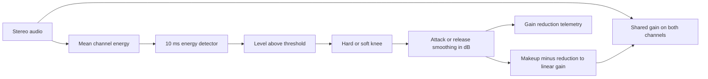

# Stateful Faust compressor

The existing compressor now owns its detector and gain-reduction state in Faust.
Its controls, detector law, numerical gates, and zero declared latency are
unchanged. This migration demonstrates stateful signal graphs without changing
the surrounding host or replacing a defined algorithm with different ballistics.

Read [`compressor.dsp`](../../dsp/faust/compressor.dsp). `onePole` uses Faust
feedback composition for the detector. `ballistics` feeds the prior reduction
back into the attack/release decision. No prior-state inputs or next-state
feedback through C++ remain. The graph returns processed stereo audio and
detector, reduction, and linear-gain telemetry. Telemetry copies never drive
the recurrence.

The graph takes nine sample-rate signals: left, right, sample rate, threshold
(dBFS), ratio, attack (ms), release (ms), knee (dB), and makeup (dB). The host
retains its existing 15 ms parameter smoothing and sends those smoothed values;
there is no second smoothing layer. Keeping controls as signals preserves the
current sample-wise automation behavior. Replacing them with block-rate UI
controls would be a separate design change.

`detail::Compressor` stores one persistent generated graph. The engine stores
one full-band graph and three independent band graphs. Mono duplicates its input
at the stereo graph boundary, retaining mono energy rather than halving it. Both
stereo channels receive one shared gain. C++ still owns crossover filters, stage
order, ingress validation, and reset/bypass policy. Full-band bypass freezes the
graph; existing multiband mode changes reset its state. Internal compressor
arithmetic remains double precision.

The adapter still calls `compute(1)` because the host performs routing and control
smoothing per sample. Persistent graph state is the change; this is not a claim
of block-processing optimization or improved CPU performance.

## Verification

The independent scalar reference in `tests/native/core_tests.cpp` retains its
existing detector, reduction, and gain tolerances. The additional public-API
`compressor_state` test checks unequal stereo, a silent channel, opposite
polarity, signal-to-silence decay, mono equivalence, reset/reprepare, bypass,
multiband reset, and independent engines/bands. Existing allocation, smoothing,
block-invariance, curve, timing, crossover, and alias checks remain required.

See [the independent numerical definitions](../evaluation/numerical-oracles.md)
and [the reproducible listening bench](README.md). Listening preference and
physical-device qualification remain separate work.
